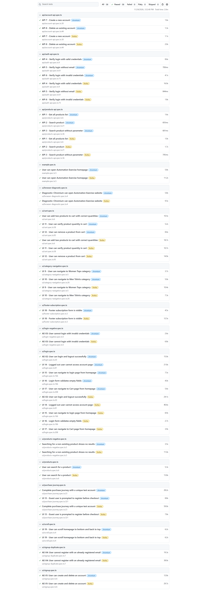

# QA Automation Framework – Playwright


A robust end-to-end test automation framework built with **Playwright and TypeScript**, designed to validate UI workflows and REST API functionality of the [Automation Exercise](https://automationexercise.com/) website.

The framework follows the **Page Object Model (POM)** design pattern and supports cross-browser testing with Chromium and Firefox.

It also includes AI-assisted Root Cause Analysis (RCA), deterministic fallback analysis, controlled fault injection, and GitHub Actions CI integration.

## Project Highlights

- UI end-to-end automation
- REST API testing
- Page Object Model architecture
- Cross-browser execution
- Reusable test fixtures and test data
- Positive and negative test scenarios
- Screenshot, video, trace and test-report support
- AI-assisted Root Cause Analysis
- Deterministic model-free RCA fallback
- Controlled fault injection (FI-01 and FI-02)
- Human review requirements for repair proposals
- GitHub Actions CI integration
- Automated test evidence collection

## Tech Stack

| Technology | Purpose |
|---|---|
| Playwright | Browser and API automation |
| TypeScript | Programming language |
| Node.js | Runtime environment |
| GitHub Actions | Continuous Integration |
| Page Object Model | Test architecture |
| Gemini API | AI-assisted RCA |
| Markdown | RCA reports and documentation |

## Project Structure

```text
qa-ai-level3/
│
├── agents/
│   ├── gemini-client.mts
│   ├── rca-agent.ts
│   ├── rca-collector.ts
│   └── test-gemini.mts
│
├── docs/
│   └── screenshots/
│       └── playwright-report.png
│
├── skills/
│   └── rca-analysis.md
│
├── src/
│   ├── api/
│   │   ├── AccountApi.ts
│   │   └── AuthApi.ts
│   │
│   ├── fixtures/
│   │   └── purchase-data.ts
│   │
│   └── pages/
│       ├── SignupPage.ts
│       ├── AccountInformationPage.ts
│       ├── ProductsPage.ts
│       ├── LoginPage.ts
│       └── CategoryPage.ts
│
├── tests/
│   ├── api/
│   │   ├── auth-api.spec.ts
│   │   ├── account-api.spec.ts
│   │   └── products-api.spec.ts
│   │
│   └── ui/
│       ├── purchase-journey.spec.ts
│       ├── login.spec.ts
│       ├── category-navigation.spec.ts
│       ├── scroll.spec.ts
│       ├── signup-duplicate.spec.ts
│       ├── cart.spec.ts
│       ├── products.spec.ts
│       ├── products-negative.spec.ts
│       ├── login-negative.spec.ts
│       ├── signup.spec.ts
│       ├── browser-diagnostic.spec.ts
│       └── fault-injection-fi02.spec.ts
│
├── tools/
│   └── rca/
│       ├── FI-01/
│       │   ├── evidence/
│       │   └── FI-01-report.md
│       └── FI-02/
│           ├── evidence/
│           └── FI-02-report.md
│
├── reports/
│   ├── junit-results.xml
│   ├── test-results.json
│   └── smoke/
│
├── .github/
│   └── workflows/
│       └── playwright.yml
│
├── playwright.config.ts
├── package.json
└── README.md
```

## Test Coverage

### UI Automation

The UI automation suite covers the following workflows:

- User registration
- Login and logout
- Duplicate email validation
- Invalid login validation
- Product search
- Search with no matching results
- Category navigation
- Cart functionality
- Product quantity verification
- Product removal from cart
- Scrolling and navigation
- Complete purchase journey
- Guest checkout validation
- Footer subscription visibility

### API Automation

Eight API scenarios are covered:

| API | Scenario |
|---|---|
| API 1 | Get all products list |
| API 2 | Search product |
| API 3 | Search product without parameter |
| API 4 | Verify login with valid credentials |
| API 5 | Verify login without email |
| API 6 | Verify login with invalid credentials |
| API 7 | Create a new account |
| API 8 | Delete an existing account |

API tests validate response status, response codes, messages and response data.

**API response note:** Account endpoints currently return valid JSON response bodies with a `text/html` Content-Type header. The framework logs this server-side header inconsistency while validating the JSON body and expected API response values.

## Browser Support

Tests are configured to run on:

- Chromium
- Firefox

## Test Execution Results

The latest verified local test execution completed successfully.

| Metric | Result |
|---|---:|
| Total test instances | 60 |
| Passed | 58 |
| Failed | 0 |
| Skipped | 2 |
| Browsers | Chromium and Firefox |
| Workers | 1 |
| Execution time | Approximately 5.3 minutes |
| Local execution | Passed |
| GitHub Actions | Passed |

The two skipped instances belong to FI-02, the intentionally gated fault-injection test.

## Test Execution Evidence

The following screenshot demonstrates the Playwright test execution report.



## Installation

Clone the repository:

```bash
git clone https://github.com/JUNAIDSHER/qa-ai-level3.git
```

Navigate to the project:

```bash
cd qa-ai-level3
```

Install dependencies:

```bash
npm install
```

Install Playwright browsers:

```bash
npx playwright install
```

## Running Tests

Run the complete test suite:

```bash
npx playwright test
```

Run tests on Chromium:

```bash
npx playwright test --project=chromium
```

Run tests on Firefox:

```bash
npx playwright test --project=firefox
```

Run tests with one worker:

```bash
npx playwright test --workers=1
```

Run API tests:

```bash
npx playwright test tests/api/
```

Run a specific test file:

```bash
npx playwright test tests/ui/login.spec.ts
```

## Test Reports

Open the Playwright HTML report:

```bash
npx playwright show-report
```

The framework also generates:

- HTML report
- JUnit XML report
- JSON test results
- Failure screenshots
- Execution videos
- Playwright traces

## AI-Assisted Root Cause Analysis

The project includes an AI-assisted RCA workflow designed to help analyze test failures.

### RCA Components

- `agents/rca-agent.ts`: AI-assisted failure analysis and structured RCA generation.
- `agents/rca-collector.ts`: Deterministic collection and summary of test failures.
- `agents/gemini-client.mts`: Gemini client integration.
- `skills/rca-analysis.md`: RCA analysis instructions and guidelines.

### RCA Capabilities

- Failure evidence collection
- Failure classification
- Root cause analysis
- Evidence-based repair proposals
- Structured RCA reports
- Human approval requirement
- Model-free deterministic fallback

AI-generated repair proposals are not automatically applied. Human review is required before approving any repair.

### Fault Injection

**FI-01 – Script Fault**

An intentional incorrect locator is introduced to reproduce a UI automation failure. The failure is analyzed, evidence is collected and the locator is restored.

**FI-02 – Network Fault**

An HTTP 503 response is intentionally injected during product search to simulate a network failure.

FI-02 is gated and skipped during normal test execution unless explicitly enabled.

Run FI-02 using PowerShell:

```powershell
$env:RUN_FAULT_INJECTION="true"
npx playwright test tests/ui/fault-injection-fi02.spec.ts --workers=1
Remove-Item Env:RUN_FAULT_INJECTION
```

FI-02 review and repair approval remain subject to human review.

## Continuous Integration

This project integrates with **GitHub Actions** to execute automated tests in CI.

The workflow supports:

- Push events
- Pull requests
- Manual workflow execution
- Scheduled daily execution
- Chromium and Firefox testing
- Test report generation
- Failure evidence and artifact collection

The scheduled workflow uses `00:00 UTC`, corresponding to `05:00 AM Pakistan Standard Time`.

The latest GitHub Actions workflow execution completed successfully.

[View GitHub Actions](https://github.com/JUNAIDSHER/qa-ai-level3/actions)

## Architecture

The framework uses the Page Object Model design pattern.

- Page classes contain reusable locators and page actions.
- Test files contain test scenarios and assertions.
- Fixtures provide reusable test setup and test data.
- API classes organize API-related operations.
- RCA agents analyze and summarize failures.
- RCA skills provide structured analysis guidance.
- GitHub Actions automates test execution.

This separation improves maintainability, readability and reusability.

## Documentation Maintenance and Final Submission

### Save and Push Documentation Changes

After updating the README or other project documentation, save and push the changes to GitHub.

Run these commands in PowerShell:

```powershell
git add README.md
git commit -m "Update README with latest test results and RCA documentation"
git push origin master
```

### Repository Verification

Before final submission, verify that:

- All documented file paths match the actual repository structure.
- The Playwright screenshot exists at `docs/screenshots/playwright-report.png`.
- RCA reports and fault-injection evidence are present.
- Test execution results reflect the latest verified run.
- GitHub Actions workflow status is successful.

### Final Submission Checklist

- [ ] README documentation updated.
- [ ] Project structure verified.
- [ ] Local Playwright test suite executed.
- [ ] Chromium and Firefox results verified.
- [ ] API 1–8 scenarios verified.
- [ ] FI-01 evidence and RCA report checked.
- [ ] FI-02 evidence and pending human-review status documented.
- [ ] GitHub Actions execution verified.
- [ ] Requirement Traceability Matrix reviewed.
- [ ] Remaining assignment gaps identified and documented.

### Requirement Coverage Review

The final submission should include a Requirement Traceability Matrix mapping assignment requirements to corresponding test cases and implementation status.

Requirements must be classified as:

- **Covered:** Implemented and verified.
- **Partial:** Some functionality is implemented, but additional validation is needed.
- **Missing:** Not yet implemented.
- **Pending Review:** Evidence or human approval is still required.

Only verified implementation and evidence should be marked as complete.

## Author

**Junaid Sher**

GitHub: [JUNAIDSHER](https://github.com/JUNAIDSHER)

Repository: [qa-ai-level3](https://github.com/JUNAIDSHER/qa-ai-level3)

---

This project demonstrates practical skills in UI automation, API testing, TypeScript, Playwright, cross-browser testing, CI/CD, fault injection and AI-assisted quality engineering.
